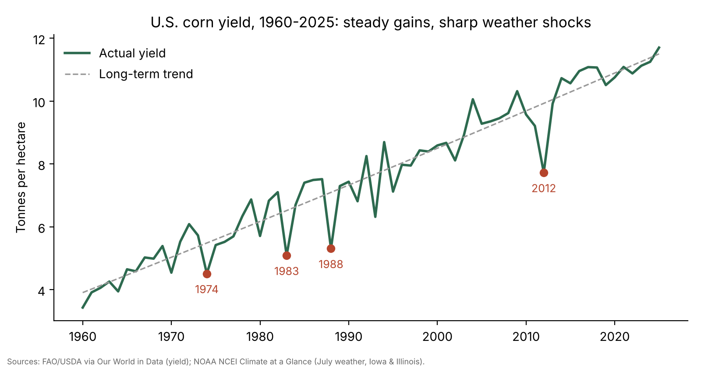
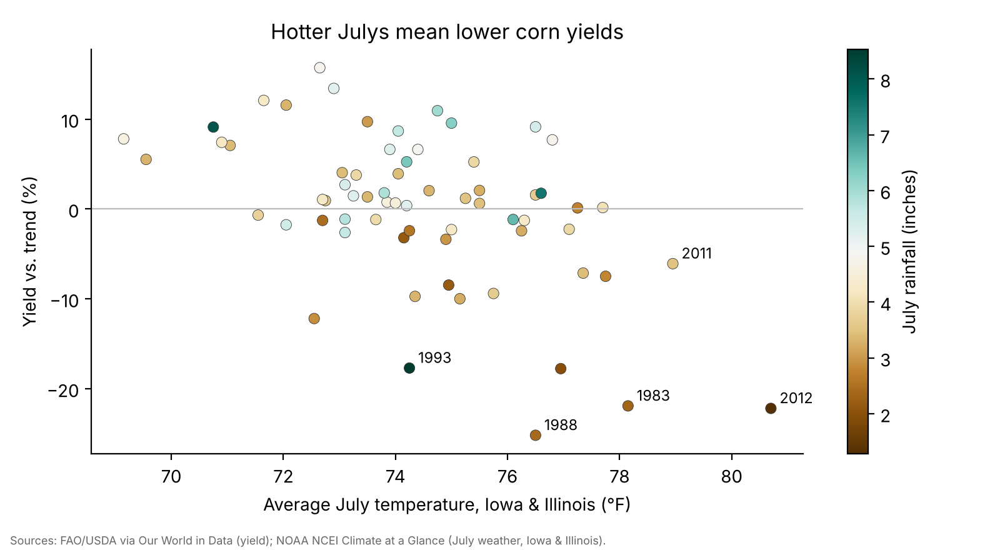

# Heat, Drought and U.S. Corn Yields

How much do hot, dry Julys cost the U.S. corn harvest? A Python analysis of 66 years (1960–2025) of national yield data and Corn Belt weather records.



## Why I built it

U.S. corn yields have more than tripled since 1960, but some years still collapse, like the 2012 drought. I wanted to separate long-term progress (better seeds and farming) from weather shocks and measure how much July heat and rain actually explain. I started it while researching agricultural research priorities for an internship application.

## What it does

- Combines U.S. corn yields (FAO/USDA via Our World in Data) with NOAA July temperature and rainfall for Iowa and Illinois, the two largest corn states
- Removes the long-term technology trend with a quadratic fit, so each year is measured as a % above or below expected yield
- Fits a linear regression of the yield gap on July temperature and rainfall anomalies
- Flags hot-and-dry years and compares them with all other years
- Produces two charts and a short written report

## How it works

```
OWID yield CSV ──┐
                 ├─> merge on year ─> detrend (quadratic) ─> % gap vs trend
NOAA July weather┘                                            │
(IA + IL avg temp, rain)                                      v
                                    OLS: gap ~ temp anomaly + rain anomaly
                                                              │
                                              charts + key_stats.csv + report
```

**Design choices**
- **July only**: corn pollinates in July, the stage most sensitive to heat and dry soil.
- **Iowa + Illinois average**: a simple proxy for Corn Belt weather, since national yields are driven mostly by these states.
- **Quadratic trend**: captures yield gains that sped up over time without overfitting.

## Results

| Metric | Value |
|---|---|
| Yield growth, 1960 → 2025 | 3.43 → 11.71 t/ha (3.4x) |
| Effect of +1°F July temperature | about **−1.7%** yield vs trend |
| Effect of +1 inch July rain | about **+1.6%** yield vs trend |
| Correlation with yield gap | temperature −0.52, rainfall +0.39 |
| Variance explained (R²) | 0.34 |
| 10 hottest/driest Julys (temp > +1.5°F, rain < −0.5 in) | average **−10.9%** vs trend |
| All other years | average +1.9% vs trend |

Worst years: 1988 (−25.2%), 2012 (−22.2%), 1983 (−21.9%), 1974 (−17.8%), and 1993 (−17.7%). 1993 was the Great Flood, a reminder that too much water hurts too.



The full write-up is in [`report/Waleed_Saffouri_Writing_Sample.pdf`](report/Waleed_Saffouri_Writing_Sample.pdf).

## Limitations and what I'd do next

- National yields with weather from only two states, and only one month of weather
- A straight-line rain effect can't capture that both drought and floods hurt (a squared term or binned model would)
- Shows associations, not proof of cause
- Next: county-level yields from USDA NASS, daily temperatures (hours above 86°F), and soil moisture data

## Setup

```bash
git clone https://github.com/Waleed-Saffouri/corn-heat-yields.git
cd corn-heat-yields
python3 -m venv .venv && source .venv/bin/activate
pip install -r requirements.txt
python analysis.py
```

Outputs go to `charts/` and `data/`. No API keys needed; the source data is included in `data/`.

## Data sources

- Our World in Data, [Corn yields](https://ourworldindata.org/grapher/maize-yields) (FAO and USDA data)
- NOAA National Centers for Environmental Information, [Climate at a Glance: Statewide Time Series](https://www.ncei.noaa.gov/access/monitoring/climate-at-a-glance/statewide/time-series) (Iowa and Illinois, July)

## Tech stack

Python, pandas, NumPy, Matplotlib
